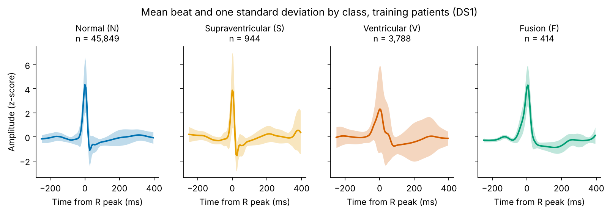
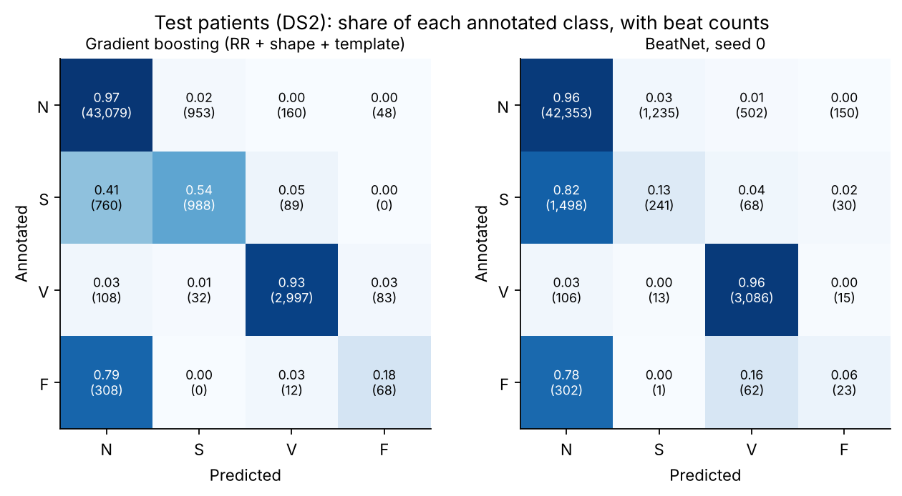
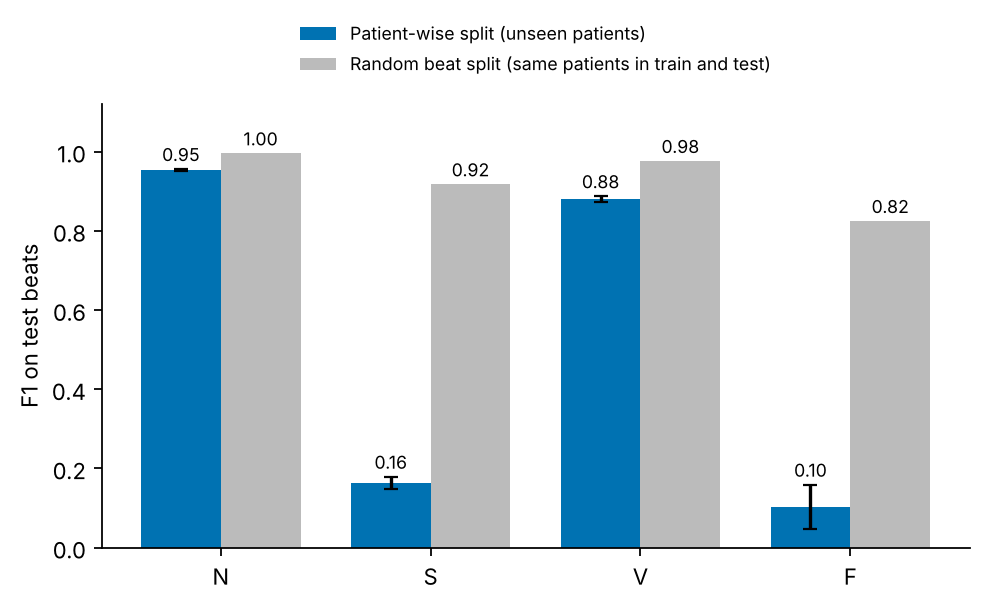

# ECG heartbeat classification on unseen patients

Deep learning and classical machine learning for classifying single heartbeats from the MIT-BIH Arrhythmia Database into the four AAMI classes (normal, supraventricular ectopic, ventricular ectopic, and fusion), with every model evaluated on patients it never saw during training.

The question I wanted to answer was a practical one: how much of the accuracy reported for ECG beat classifiers survives when the test patients are new, and what actually helps a model generalize to them?

## Summary of findings

1. Splitting beats at random, so that the same patients appear in training and test, makes the network look far better than it is. The same architecture scores a macro F1 of 0.929 under a random beat split and 0.525 on unseen patients.
2. Describing each beat relative to its own patient mattered more than the choice of model. Adding a label-free patient template (the median beat of that recording) raised gradient boosting from a macro F1 of 0.493 to 0.662 and the network from 0.467 to 0.525, and it removed the false ventricular alarms in patients with bundle branch block.
3. On this dataset the gradient-boosted trees generalized better than the convolutional network. The network detected ventricular ectopic beats slightly more often (sensitivity 0.958 against 0.931) but with more false alarms, and it was much weaker on supraventricular beats.
4. Supraventricular and fusion beats remain hard for every model here, which is consistent with how few patients contribute them to the training set.

## Data

The MIT-BIH Arrhythmia Database (Moody & Mark, 2001) holds 48 half-hour two-lead ambulatory ECG recordings sampled at 360 Hz, with every beat annotated by cardiologists, and is distributed by PhysioNet (Goldberger et al., 2000). The data are not included in this repository; `src/download_data.py` fetches them from PhysioNet.

Following the AAMI EC57 recommendation, the four paced recordings are excluded and beat annotations are grouped into classes N, S, V, and F. Paced and unclassifiable beats (class Q) are not modelled. Patients are divided as in de Chazal et al. (2004): 22 recordings for training (DS1) and 22 different recordings for testing (DS2).

| Set | N | S | V | F |
| --- | --- | --- | --- | --- |
| DS1 (training patients) | 45,849 | 944 | 3,788 | 414 |
| DS2 (test patients) | 44,240 | 1,837 | 3,220 | 388 |



## Method

Signal processing. The modified limb lead II signal is band-pass filtered (0.5 to 40 Hz, zero phase) and scaled per recording. Each beat is a window from 250 ms before to 400 ms after the annotated R peak, kept at 180 Hz (117 samples).

Rhythm features. Four RR-interval ratios describe the rhythm around each beat: the previous and the next interval relative to the mean of the ten preceding intervals, the previous interval relative to the recording mean, and the next interval relative to the previous one. Ratios are used instead of intervals in seconds because resting heart rate differs between patients.

Patient template. For each recording, the median of all its beats is computed without using any labels, and each beat's deviation from that template is given to the model alongside the beat itself. A beat that is wide for one patient may be entirely usual for another, and the template lets the model see that.

Models.

- Logistic regression on the RR ratios alone, to show what rhythm contributes without any beat shape.
- Gradient-boosted trees (scikit-learn `HistGradientBoostingClassifier`) on the RR ratios and a downsampled beat, with and without the template deviation.
- BeatNet, a small one-dimensional residual network in PyTorch (61,492 parameters). Three residual blocks read the beat and its template deviation as two input channels, a small dense branch reads the RR ratios, and the two are joined before the classifier. Training uses AdamW with a one-cycle learning rate, a class-weighted cross-entropy loss, and augmentation by random gain, small time shifts, and noise.

Evaluation protocol. Five DS1 patients were held out to choose the architecture and the number of epochs. The network was then retrained on all 22 DS1 patients for that fixed number of epochs and tested once on DS2, with three random seeds. Per-class sensitivity (Se), positive predictive value (PPV), and macro F1 are reported, because accuracy is dominated by the normal class.

## Results on the 22 test patients

| Model | Macro F1 | Accuracy | N Se | N PPV | S Se | S PPV | V Se | V PPV | F Se | F PPV |
| --- | --- | --- | --- | --- | --- | --- | --- | --- | --- | --- |
| Logistic regression, RR ratios only | 0.461 | 0.770 | 0.787 | 0.982 | 0.513 | 0.263 | 0.781 | 0.516 | 0.018 | 0.001 |
| Gradient boosting, RR + beat shape | 0.493 | 0.892 | 0.924 | 0.986 | 0.208 | 0.179 | 0.931 | 0.544 | 0.175 | 0.117 |
| Gradient boosting, RR + beat shape + patient template | 0.662 | 0.949 | 0.974 | 0.973 | 0.538 | 0.501 | 0.931 | 0.920 | 0.175 | 0.342 |
| BeatNet, beat shape only (1 seed) | 0.377 | 0.777 | 0.799 | 0.976 | 0.102 | 0.047 | 0.939 | 0.377 | 0.062 | 0.016 |
| BeatNet, beat shape + RR (1 seed) | 0.467 | 0.852 | 0.872 | 0.978 | 0.363 | 0.205 | 0.942 | 0.507 | 0.041 | 0.016 |
| BeatNet, beat shape + RR + patient template (3 seeds, mean ± SD) | 0.525 ± 0.015 | 0.914 ± 0.004 | 0.950 ± 0.005 | 0.957 ± 0.001 | 0.155 ± 0.023 | 0.176 ± 0.011 | 0.958 ± 0.003 | 0.814 ± 0.012 | 0.095 ± 0.046 | 0.119 ± 0.069 |



The template's effect is clearest in individual patients. In recording 111, whose every beat shows left bundle branch block, the network without the template labelled 1,197 of 2,123 normal beats as ventricular; with the template it mislabelled 3. In recording 212 (right bundle branch block), normal beats mislabelled as supraventricular fell from 897 to none.

### Why the split matters

Trained and tested on a random 70/10/20 division of beats, with the same patients on both sides, the same network reaches a macro F1 of 0.929 and an accuracy of 0.991. The figures below compare the per-class F1 of the two protocols. The difference is largest for the rare classes, where a model can memorize how a particular patient's ectopic beats look.



## Limitations

- The patient template was added after a first evaluation on DS2 showed that the errors were concentrated in patients with bundle branch block. That decision was therefore informed by the test set, and the DS2 results for the template models should be read with that in mind. Hyperparameters were otherwise chosen on held-out DS1 patients only.
- The network was not tuned extensively, and a larger search, pretraining on a bigger ECG corpus, or a longer rhythm context might close the gap to gradient boosting. I report the result as it stands.
- Validation scores varied from epoch to epoch (macro F1 between 0.46 and 0.73 over ten epochs), because five patients are a small validation set.
- Fusion beats come almost entirely from one training patient, and no model here detects them reliably.
- R-peak locations are taken from the database annotations, so the results do not include beat detection errors.
- Recordings 201 and 202 come from the same person and fall on opposite sides of the standard DS1 and DS2 division, which I kept for comparability with published work.
- The database is small (44 recordings used) and was recorded between 1975 and 1979 at a single hospital. This is a methods exercise and not a clinical tool.

## Reproducing the results

```bash
pip install -r requirements.txt
./run_all.sh
```

The script downloads the data, segments the beats, fits the baselines, trains every network, and rebuilds the figures and `results/summary.md`. It takes about eight minutes on two CPU cores and needs no GPU. Individual steps:

| Step | Command |
| --- | --- |
| Download data | `python src/download_data.py` |
| Segment beats | `python src/prepare_beats.py` |
| Baselines | `python src/baseline.py` |
| Validate on held-out DS1 patients | `python src/train_cnn.py --split inter --stage validate` |
| Train on DS1, test on DS2 | `python src/train_cnn.py --split inter --stage final --seed 0` |
| Random-split comparison | `python src/train_cnn.py --split intra` |
| Figures and table | `python src/figures.py` |

Every metric in this README is stored in `results/` as JSON, including per-patient confusion matrices for the test set, and the trained weights for seed 0 are in `results/beatnet_seed0.pt`.

## References

de Chazal, P., O'Dwyer, M., & Reilly, R. B. (2004). Automatic classification of heartbeats using ECG morphology and heartbeat interval features. IEEE Transactions on Biomedical Engineering, 51(7), 1196–1206.

Goldberger, A. L., Amaral, L. A. N., Glass, L., Hausdorff, J. M., Ivanov, P. C., Mark, R. G., Mietus, J. E., Moody, G. B., Peng, C.-K., & Stanley, H. E. (2000). PhysioBank, PhysioToolkit, and PhysioNet: Components of a new research resource for complex physiologic signals. Circulation, 101(23), e215–e220.

Moody, G. B., & Mark, R. G. (2001). The impact of the MIT-BIH Arrhythmia Database. IEEE Engineering in Medicine and Biology Magazine, 20(3), 45–50.

## License

Code is released under the MIT License. The MIT-BIH Arrhythmia Database is distributed by PhysioNet under its own terms.
